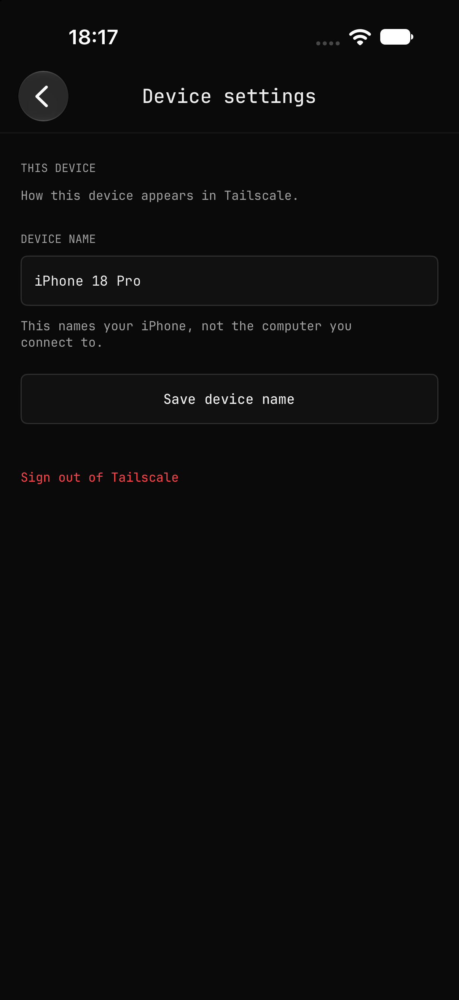
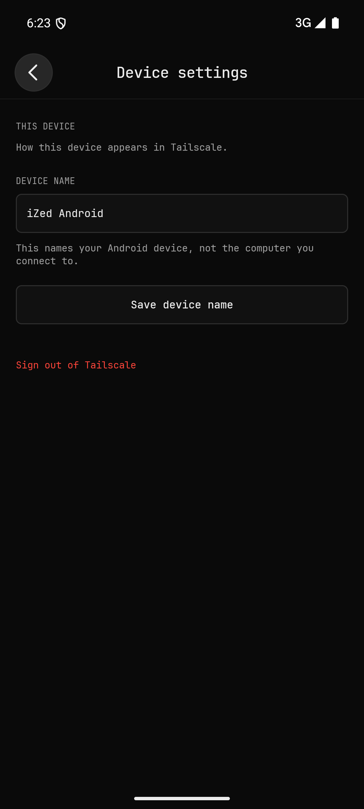

# Android terminal visual review

These are unedited simulator captures after reconciling main commit `3ed0743e1227b259ee7fafe9d562a5443bac5aff`. Displayed machines are synthetic catalog examples or the isolated SSH fixture. No sign-in screens, private keys, enrollment URLs or personal desktop content are included.

The iOS picker, device settings and trust references use current production UIKit source in a credential-free phone catalog harness. Both terminal captures are from the reconciled live SSH tests. iOS uses a 402-point-wide phone and Android a 411.43-dp-wide emulator. Safe areas, fixture row counts and trust states differ; these are visual comparisons, not pixel-diff assertions. Android's picker capture precedes live roster population and already shows the saved fixture.

The terminal renderer, eight-button accessory strip, session switcher and terminal options are shared. Android follows the updated picker layout, including the grouped settings/refresh controls and separate device settings. System fonts, keyboard layouts and native alert materials differ by OS; Android uses blur when supported and an opaque fallback otherwise. Apple font files are not redistributed.

| Screen | iOS | Android |
| --- | --- | --- |
| Machine picker |  |  |
| Device settings |  |  |
| Host trust |  |  |
| Live terminal |  |  |

## Validation

Final Android smoke run: 10/10 checks passed—trust rejection, independent fingerprint verification, persistent identity, SSH public-key authentication, ANSI/UTF-8 output, typed input, accessory Ctrl-C, hardware Ctrl-C, PTY resize (50×21 and 50×37), and background/resume. The original public identity remained unchanged across process restarts. The terminal options keyboard action was also checked.

Final iOS live regression: 2/2 XCTest cases passed (`testHostVerificationAfterPickerDismissal`, `testPhoneSSHAndKeyboard`), including exact fixture fingerprint verification and actual software keyboard letter keys. Android Rust/Java/APK builds and the iOS simulator library/build-for-testing checks passed with bounded concurrency and locked/offline Rust dependencies.

One earlier Android attempt encountered a startup focus-event ANR while both simulators were running under load. The final Android retry and final iOS run passed sequentially with only one simulator running. This does not establish that the contention-related ANR is impossible under other load conditions. Temporary fixture/helper services and both simulators were stopped afterward; persistent identities were retained.

Final tested debug APK SHA256: `d453a0569fa0570db671fc94acc86a05146bb195182b58ec69b506948fc85858`.
