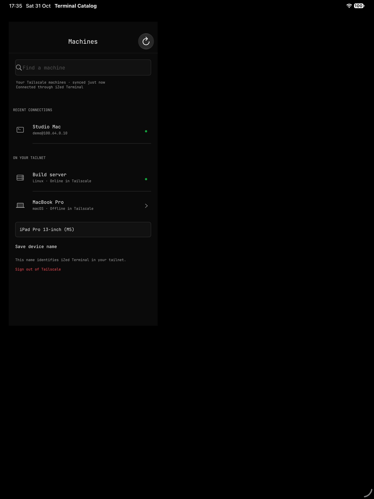
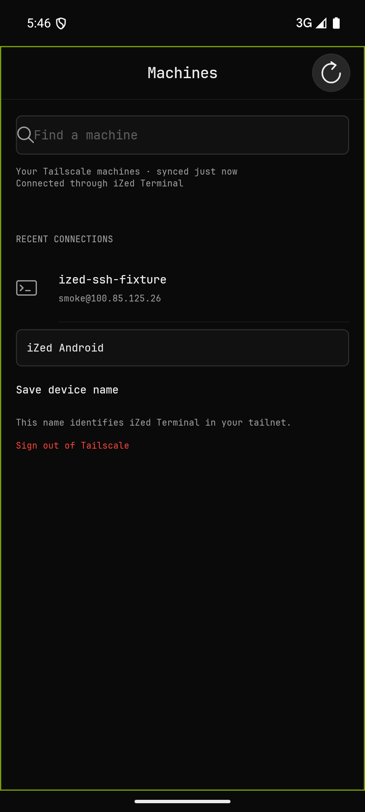
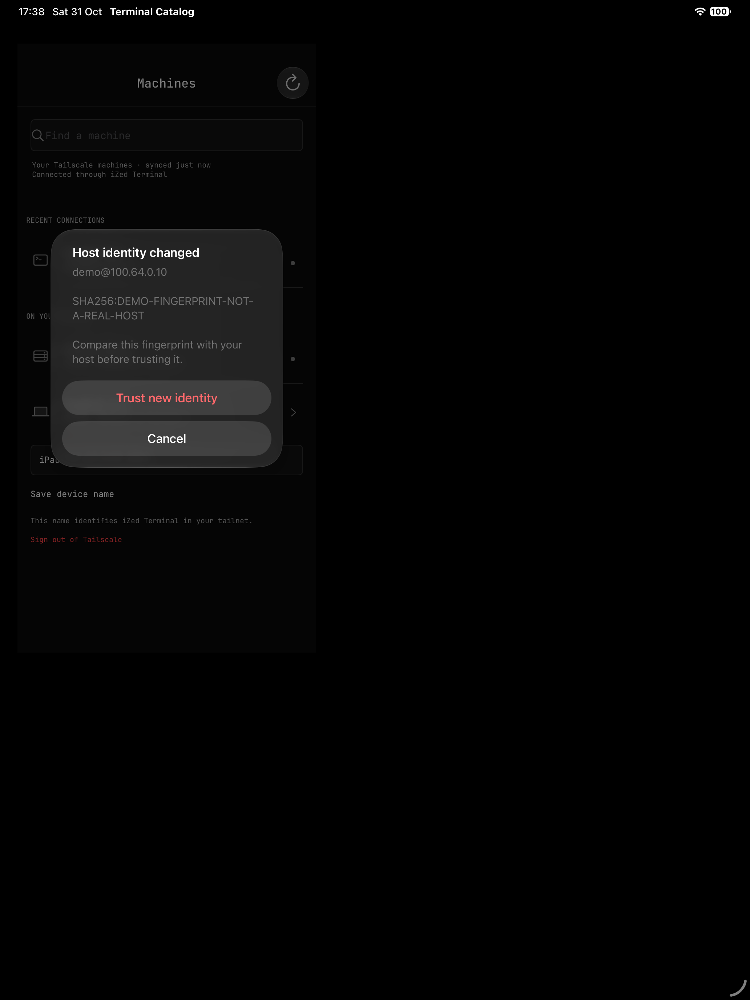
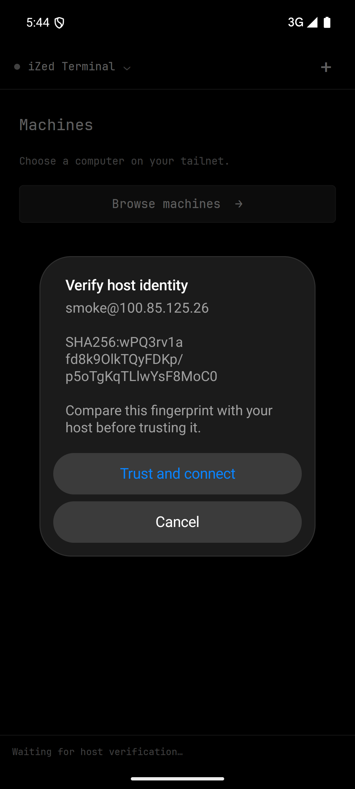
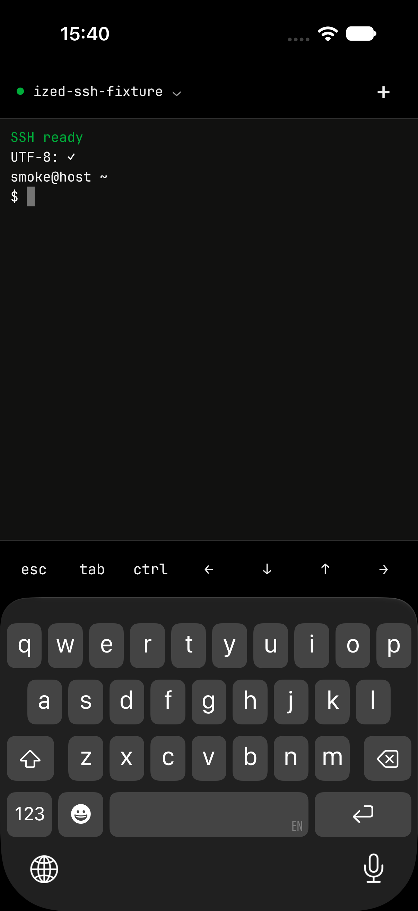
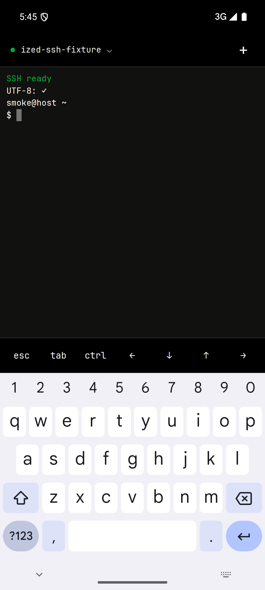

# Android terminal visual review

These are unedited simulator captures. All displayed machines/accounts are catalog examples or the isolated SSH test fixture. No account sign-in screens, private keys, enrollment URLs, or personal desktop content are included.

The iOS picker and trust references use the production UIKit source in a credential-free catalog harness. Its 411.43-point-wide app window is visible in the upper-left of a full iPad screenshot; the surrounding black canvas is not part of the phone layout. Android uses a 411.43-dp-wide emulator and the final installed application. Device safe areas, number of fixture rows, and trust state differ, so these are visual references rather than pixel-diff assertions.

The iOS terminal is from the earlier live SSH baseline; Android is from the final ten-check smoke run. Both show the same synthetic SSH-ready/UTF-8 output. The terminal renderer and accessory controls are shared. System keyboards, system fonts, and native alert materials differ by OS; Android uses background blur when supported, otherwise an opaque fallback. Apple font files are not redistributed.

| Screen | iOS | Android |
| --- | --- | --- |
| Machine picker |  |  |
| Host trust |  |  |
| Live terminal |  |  |

## Validation

Final Android smoke run: all ten checks passed: trust rejection, independent fingerprint verification, identity persistence, SSH public-key authentication, ANSI/UTF-8 output, typed input, accessory Ctrl-C, hardware Ctrl-C, PTY resize (50×21 and 50×37), and background/resume. The original public identity remained unchanged across process restarts; emulator restart also preserved app data. Temporary fixture services were stopped afterward.

Android build and Java compilation passed. The shared-code iOS simulator library check passed with locked offline dependencies; the earlier live iOS baseline passed before the Android implementation. No new live iOS regression run is claimed here.

Final tested debug APK SHA256: `e8b2f4e197d4eabe15cc9b7fe178b563a9880fc73050b87c207fef065cc07bb5`.
